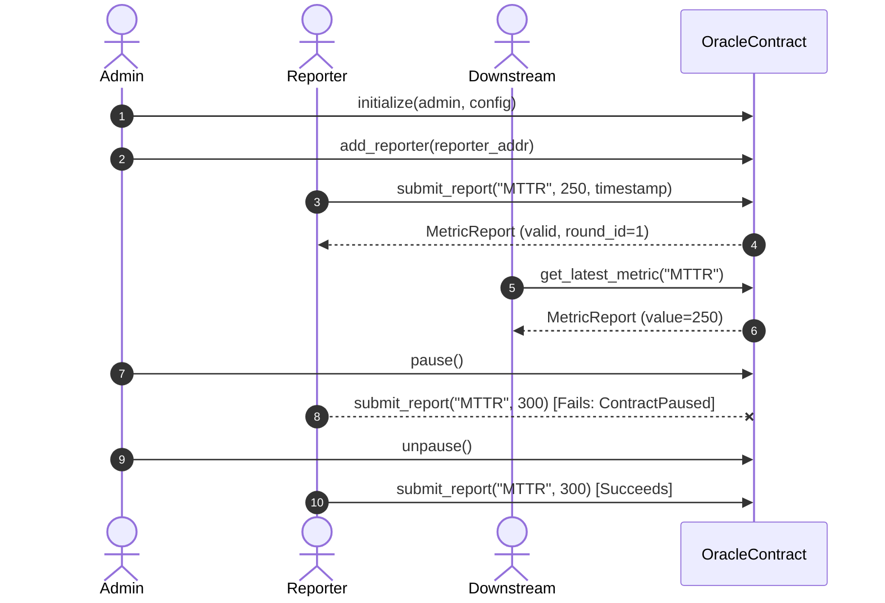

# Oracle Architecture, Security, and Testing Specification

> **Tracking Issues:**
> - [#846](https://github.com/ApexChainx/ApexChainx-Contracts/issues/846): Check Oracle for integer overflow/underflow risks
> - [#844](https://github.com/ApexChainx/ApexChainx-Contracts/issues/844): Audit Oracle access control modifiers
> - [#845](https://github.com/ApexChainx/ApexChainx-Contracts/issues/845): Add invariant tests for Oracle
> - [#843](https://github.com/ApexChainx/ApexChainx-Contracts/issues/843): Add integration tests covering Oracle flows

---

## 1. Overview

The `OracleContract` ([apexchainx_calculator/src/oracle.rs](file:///home/zakayola/Music/ApexChainx-Contracts/apexchainx_calculator/src/oracle.rs)) provides verified telemetry and data feed ingestion for the ApexChainx ecosystem. Downstream consumers such as `SLACalculatorContract` utilize oracle feeds to receive deterministic outage MTTR, latency, and system health metrics.

---

## 2. Integer Overflow/Underflow Protections (#846)

All numeric computations in the Oracle contract are performed with strict overflow and underflow safeguards:

| Operation | Implementation | Guard Condition | Error Code |
|---|---|---|---|
| Addition | `safe_add(a, b)` | `a.checked_add(b)` | `OracleError::MathOverflow` (106) |
| Subtraction | `safe_sub(a, b)` | `a.checked_sub(b)` | `OracleError::MathUnderflow` (107) |
| Multiplication | `safe_mul(a, b)` | `a.checked_mul(b)` | `OracleError::MathOverflow` (106) |
| Division | `safe_div(a, b)` | `b != 0` & `checked_div` | `OracleError::DivisionByZero` (108) |
| Weighted Average | `safe_weighted_average` | Checked product & weight sum | `MathOverflow`, `DivisionByZero` |
| Rate of Change | `safe_calculate_rate_change` | Absolute difference & scaled div | `MathOverflow`, `DivisionByZero` |
| Config Bounds | `[min_allowed_value, max_allowed_value]` | Range check on incoming reports | `OracleError::ValueOutOfBounds` (109) |

---

## 3. Access Control Modifiers & Authorization Matrix (#844)

The Oracle employs a role-based access control (RBAC) model verified via Soroban `require_auth()` checks:

| Role | Permissions | Guards & Modifiers |
|---|---|---|
| **Admin** | `initialize`, `set_config`, `add_reporter`, `remove_reporter`, `pause`, `unpause` | `require_admin(caller)` |
| **Reporter** | `submit_report` | `require_reporter(caller)`, `require_not_paused` |
| **Public / Downstream** | `get_latest_metric`, `aggregate_reports`, `is_reporter`, `is_paused` | `require_initialized` |

### Security Modifiers:
- `require_initialized(env)`: Protects state against uninitialized reads or operations.
- `require_admin(env, caller)`: Enforces that the caller matches the recorded admin and has signed the transaction (`caller.require_auth()`).
- `require_reporter(env, caller)`: Checks that the caller is active in the reporter mapping and signed the transaction.
- `require_not_paused(env)`: Blocks state mutations during emergency stops.

---

## 4. System Invariants (#845)

The automated invariant test suite enforces the following properties:

1. **Timestamp Monotonicity:**
   - For any sequence of reports $R_i, R_{i+1}$ on metric $M$:
   $$\text{timestamp}(R_{i+1}) \ge \text{timestamp}(R_i)$$
   - Regressive timestamps are rejected with `TimestampRegression`.

2. **Metric Value Boundedness:**
   - Every accepted report $V$ satisfies:
   $$\text{min\_allowed\_value} \le V \le \text{max\_allowed\_value}$$

3. **Consensus Mean & Median Containment:**
   - For any set of reports $\{r_1, r_2, \dots, r_n\}$:
   $$\min(r_i) \le \text{consensus\_value} \le \max(r_i)$$
   $$\min(r_i) \le \text{mean\_value} \le \max(r_i)$$

4. **Revocation Immediacy:**
   - Once a reporter is removed by admin, subsequent submissions fail immediately with `ReporterNotAuthorized`.

---

## 5. Integration Flows (#843)

The Oracle contract undergoes full lifecycle integration testing:

